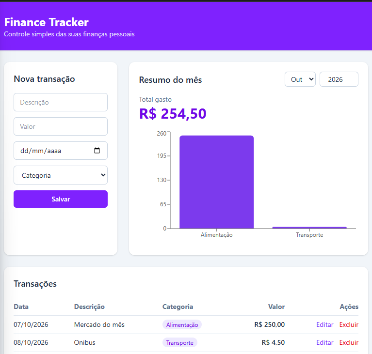

# Finance Tracker

Aplicação full stack para controle de finanças pessoais: API REST em Python
(FastAPI) e interface web em React, construída para praticar desenvolvimento
back-end e front-end.



## Funcionalidades
- Cadastro, listagem, edição e exclusão de transações (CRUD completo)
- Categorias, com bloqueio de duplicatas
- Filtro por mês e ano
- Resumo mensal: total gasto e total por categoria
- Gráfico de barras por categoria
- Valores e datas no padrão brasileiro (R$ 1.250,00 e 07/10/2026)
- Testes automatizados da API

## Stack
**Back-end:** Python 3.13, FastAPI, SQLAlchemy 2.0 (ORM), SQLite, Pydantic v2,
Uvicorn, pytest.
**Front-end:** React, Vite, Tailwind CSS, Recharts.
**Ferramentas:** Git, npm, pip.

## Arquitetura
```
React (porta 5173)  ──fetch/JSON──►  FastAPI (porta 8000)  ──SQLAlchemy──►  SQLite
```
O front-end e a API rodam em servidores separados. A API libera o front-end
via CORS.

## Endpoints
| Método | Rota | Descrição |
|---|---|---|
| GET | /categorias | Lista categorias |
| POST | /categorias | Cria categoria |
| GET | /transacoes | Lista transações (filtros: mes, ano, categoria_id) |
| POST | /transacoes | Cria transação |
| PUT | /transacoes/{id} | Edita transação |
| DELETE | /transacoes/{id} | Exclui transação |
| GET | /resumo?mes=&ano= | Total do mês e total por categoria |

## Decisões técnicas
- **Camadas separadas no back-end**: `database.py` (conexão), `models.py`
  (tabelas), `schemas.py` (contratos de entrada e saída), `main.py` (rotas).
- **Schemas de entrada e saída** (`Create` e `Out`), para o cliente nunca
  definir o `id`.
- **Integridade referencial**: transação só é criada ou editada se a categoria
  existir (404 caso contrário).
- **Valores monetários com `Decimal`**, evitando erros de arredondamento.
- **Filtros por intervalo de datas** e **agregação no banco** (`SUM` com
  `GROUP BY`), em vez de calcular em Python.
- **Testes isolados**: banco SQLite em memória por teste, com
  `dependency_overrides`; o banco real nunca é tocado.
- **Formulário único** no front-end para criar e editar, alternando entre
  `POST` e `PUT`.

## Como rodar

**1. Back-end** (em um terminal, na raiz do projeto):
```
python -m venv .venv
.venv\Scripts\activate.bat
pip install -r requirements.txt
python -m uvicorn app.main:app --reload
```
Documentação interativa da API: http://127.0.0.1:8000/docs

**2. Front-end** (em outro terminal):
```
cd frontend
npm install
npm run dev
```
Interface: http://localhost:5173

## Testes
```
python -m pytest -v
```

## Estrutura
```
app/            API (FastAPI)
tests/          testes da API (pytest)
frontend/       interface (React + Vite + Tailwind)
docs/           imagens do README
```

## Próximos passos
- Autenticação de usuários
- Cadastro de categorias pela interface
- Deploy em nuvem

## Aprendizados
Ambiente virtual e dependências, ORM, chaves primária e estrangeira, ciclo de
sessão e commit, códigos HTTP, testes automatizados, CORS, hooks do React
(`useState`, `useEffect`), consumo de API com `fetch`, estilização com
Tailwind, gráficos com Recharts, versionamento com Git e diagnóstico de
bloqueios de segurança do Windows.